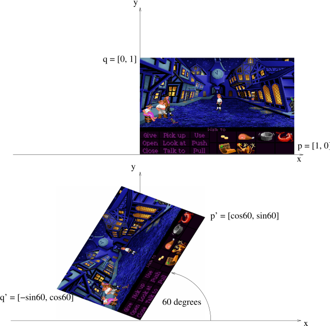

# Making class slides in Quarto instead of Beamer

A working tutorial for GAME 220. It assumes you know Beamer and want the
equivalent moves in Quarto, not an introduction to either.

Everything below was tested against this folder on this machine. Where
something does not work, it says so and says what to do instead.

- [1. The mental model](#1-the-mental-model)
- [2. Setup](#2-setup)
- [3. Creating a deck](#3-creating-a-deck)
- [4. Writing slides](#4-writing-slides)
- [5. Figures](#5-figures)
- [6. Interactive labs](#6-interactive-labs)
- [7. Presenting](#7-presenting)
- [8. Sharing](#8-sharing)
- [9. Bringing an old Beamer deck across](#9-bringing-an-old-beamer-deck-across)
- [10. Troubleshooting](#10-troubleshooting)

---

## 1. The mental model

Beamer compiles LaTeX to a PDF. Quarto compiles Markdown to an HTML page that
happens to be a slideshow, driven by reveal.js.

| | Beamer | Quarto |
| --- | --- | --- |
| you write | `.tex` | `.qmd` (Markdown + YAML) |
| build | `pdflatex` | `quarto render` |
| output | `main.pdf` | `matrices.html` + a folder |
| present with | any PDF viewer | a browser |
| math | LaTeX | LaTeX (MathJax) — **identical** |
| interactivity | none | anything the web can do |

The one that matters: **your math carries over untouched.** `pmatrix`,
`\sqrt`, `\angle`, `\vec`, `\hat`, `\frac` all work exactly as they did. That
is most of both your decks, and it is why this migration is transcription
rather than rewriting.

The one real cost: **output is a folder of files that must be served over
http**, not a single portable PDF. Section 8 deals with that honestly.

---

## 2. Setup

Already done on this machine. To redo it elsewhere:

```powershell
winget install --id Posit.Quarto -e
```

That is the whole dependency list. Quarto bundles pandoc and reveal.js, and the
labs are plain JavaScript in `assets/` — no npm, no network, nothing vendored.

Check it:

```powershell
quarto --version      # 1.10.18 here
```

---

## 3. Creating a deck

### Start a new one

Create `kinematics.qmd` in this folder:

```markdown
---
title: "GAME 220 - Game Dynamics 1"
subtitle: "Kinematics"
---

## First slide

Content.
```

That is a complete deck. Everything else — theme, footer, slide numbers,
chalkboard, the lab script — is inherited from `_quarto.yml`. You do not
repeat the preamble in each deck the way you did in each `.tex`.

**But only once the deck is in `_quarto.yml`'s `render:` list.** A deck not
listed there renders bare — no theme, no footer, no labs, just empty space
where each demo should be — and overwrites any good HTML it had. Add it to the
list before the first render. The full checklist for a new deck:

1. **`_quarto.yml`**: add `- kinematics.qmd` to `render:`.
2. **`.gitignore`**: add `kinematics.html` and `kinematics_files/` beside the
   other decks', so the rendered output is never committed.
3. **`index.html`**: add a card in the right course's section, copying a
   neighbour — and check its `</a>` closes it before the next card starts.
4. **Commit the source** (`git add` the `.qmd` and anything new in `assets/`),
   leaving out third-party images you only want local (PLAN.md §3.6).
5. **Publish** with `pwsh -File tools\publish.ps1 kinematics -DryRun` to see
   what would change, then again without `-DryRun` (§8).

### The edit loop

```powershell
quarto preview kinematics.qmd
```

This opens a browser and **live-reloads on every save**. Leave it running in a
terminal while you write. This is the biggest day-to-day difference from
Beamer — no compile step, no waiting, no `.aux` files.

When done, `Ctrl+C`. To build everything without previewing:

```powershell
quarto render
```

### What lands on disk

`kinematics.html` plus `kinematics_files/`, both beside the `.qmd`. They sit
next to `assets/` and `figs/`, which is why relative paths resolve. Keep them
together.

Edits to `assets/*.css` and `assets/*.js` do **not** need a re-render — just
reload the page.

---

## 4. Writing slides

### Structure

```markdown
# Section title            <- a section divider slide
## Slide title             <- a normal slide
### Heading inside a slide
```

`#` replaces `\section{}`, `##` replaces `\begin{frame}\frametitle{}`. There is
no `\end{frame}`; the next `##` ends the slide.

### Pauses

`\pause` becomes a line containing `. . .` — three dots, spaces between,
nothing else:

```markdown
## Dot product

$\vec{A}\cdot\vec{B} = |A||B|\cos\theta$

. . .

In Cartesian form: $x_1x_2 + y_1y_2$
```

For a list that reveals one bullet at a time:

```markdown
::: {.incremental}
- First
- Second
:::
```

### Columns

`\begin{columns}` becomes fenced divs. Note the **four** colons on the outer
fence and three on the inner — that is how nesting is expressed:

```markdown
:::: {.columns}

::: {.column width="55%"}
Left side.
:::

::: {.column width="45%"}

:::

::::
```

### Math

Inline `$...$` and display `$$...$$`, same as always:

```markdown
$$R(\theta) = \begin{pmatrix} \cos\theta & -\sin\theta \\
                              \sin\theta & \cos\theta \end{pmatrix}$$
```

`\degree` and your other `\newcommand` shortcuts do not exist here. Write
`^\circ` directly. If you want the shortcuts back, define them once in a hidden
math block at the top of the deck:

```markdown
$$\newcommand{\degree}{^\circ}$$
```

### Your Beamer macros

| Beamer | Quarto |
| --- | --- |
| `\alert{x}` | `[x]{.alert}` |
| `\struc{x}` / `\structure{x}` | `[x]{.struc}` |
| `\fbox{$...$}` | `$\class{boxed}{...}$` |
| `\bi \bu ... \ei` | `-` bullets |
| `\ben \bu ... \een` | `1.` numbered |
| `\includegraphics[width=6cm]{f.eps}` | `{width="60%"}` |

`.alert`, `.struc` and `.boxed` are defined in `assets/slides.css` to match the
old beaver colour scheme. Prefer relative widths (`60%`) over centimetres — the
slide scales to the projector.

### Slide options

Put them in braces after the title:

```markdown
## A dense slide {.smaller}      <- shrinks text, the fix for overflow
## A quiet slide {.center}       <- vertically centred
## Skip me {visibility="hidden"} <- kept in source, not shown
```

### Speaker notes

```markdown
::: {.notes}
Remind them the order matters here. Ask why TR and RT differ.
:::
```

Press `s` while presenting to open the speaker view in a second window.

---

## 5. Figures

The browser cannot display EPS. Everything must be SVG, PNG, or JPG. SVG is
what you want — it is line art and stays sharp at any projector resolution.

All 69 EPS figures from both old decks are already converted in `figs/`.

To convert more (from Git Bash, not PowerShell):

```bash
./tools/eps2svg.sh ../matrices ../vectors
FORCE=1 ./tools/eps2svg.sh ../vectors     # redo ones already done
```

If you still have the xfig `.fig` originals, skip EPS entirely — `fig2dev -L
svg drawing.fig drawing.svg` goes straight to a clean SVG.

Use them like this:

```markdown
{width="55%"}
```

Captions are suppressed by the theme, so alt text in the brackets is optional.

---

## 6. Interactive labs

This is the reason to be here at all. A lab is one `<div>` in the `.qmd`;
`assets/labs.js` finds it and mounts the demo, almost always on a Canvas 2D
stage (`matmul`, below, is the one exception - plain DOM, no stage).

```html
<div class="lab-mount" data-lab="2d" data-stages="rotate,translate"
     data-theta="60" data-dx="3" data-dy="0"></div>
```

The main kinds, chosen with `data-lab` (the full list, including the Physics 1
`motion` and `accel` labs, is in [README.md](README.md)):

| `data-lab` | what it does |
| --- | --- |
| `2d` (default) | matrix transforms — two tracked vertices, a shape, the composed 3×3 |
| `3d` | the same in 3D — an extruded house, three tracked vertices, the composed 4×4; drag the canvas to orbit the camera |
| `polar` | drag a vector; read $[a,b]$ and $r\angle\theta$ off it |
| `add` | tip-to-tail addition, with an A+B / A−B toggle |
| `dot` | dot product, and the projection onto $\hat{B}$ |
| `reflect` | the non-axis-aligned collision, following the five steps |
| `matmul` | step through $A \times B$ row by column, one cell of the product at a time |

Common options: `data-view` (half-height in world units), `data-matrix="false"`,
and for `2d` also `data-stages`, `data-shape`, `data-reorder` and the starting
slider values `data-theta` / `data-kx` / `data-ky` / `data-dx` / `data-dy`.
`3d` takes the same, plus `data-kz` / `data-dz`, `data-axis` (`x`, `y` or `z`)
for a plain `rotate` stage, the fixed-axis stages `rotateX` / `rotateY` /
`rotateZ` with `data-theta-x` / `-y` / `-z`, and `data-yaw` / `data-pitch` for
the starting camera. The
vector labs take `data-cx`, `data-cy`, `data-step`, `data-dp` for the camera and
number formatting, and `reflect` takes `data-preset="peggle"`. The full table is
in [README.md](README.md).

Every slider's number doubles as a text box - click it to type an exact value
(Enter or click away commits, Escape cancels) instead of dragging the thumb.
Out-of-range text clamps to the slider's min/max; unparsable text reverts.

The `2d` lab, given more than one stage, grows a row of words above the
matrix — e.g. `Rotate × Translate =` — that can be dragged left-to-right into
any order, the way you'd rearrange terms in a written-out matrix product.
Drag, then **Play**, and the same θ, scale and Δ visibly land somewhere else.
That is the slide that used to be four lines of algebra. The row is
multiplication order, not application order: the rightmost word is applied
first, matching how `TR` in the algebra reads "rotate, then translate."

The vector labs are dragged, not sliders: the black dots are handles. Two of
them are tuned to match the printed worked examples, so you can put the demo
and the algebra side by side and the numbers agree:

- `polar` starts at $[2, 3]$ and reads $3.61 \angle 56.3^\circ$.
- `reflect` with `data-preset="peggle"` uses the Peggle coordinates and reads
  $\hat{N} = [0.832, -0.555]$, $v_f = [-10, 50]$.

To add a new kind of lab, write a mode in `assets/vector-lab.js` — each one is
a `handles` list, a `draw()` that returns shapes and readout rows, and nothing
else. The scene, dragging, and layout come from `assets/lab-core.js`.

### Testing the demos

Two levels, and it is worth doing both after any change to `assets/*.js`.

**Automated.** Run `serve.cmd` and open
<http://localhost:8000/lab-selftest.html>. It mounts every lab, synthesises
real pointer drags and slider moves, reads the numbers back out of the panels,
and compares them against values worked out by hand. You want
`all 183 checks passed` in green at the top. This covers what a screenshot
cannot: that a handle can be grabbed, that dragging updates the readout, and
that the arithmetic is right at more than one position. It also asserts each
lab was drawn by Canvas 2D, since the readouts alone cannot tell you that.

If you add a lab, add a few checks — the pattern for each is "drag from a known
point to another known point, then assert the readout".

**By hand,** because the self-test cannot judge whether something *reads* well
from the back of a room:

| lab | try this | expect |
| --- | --- | --- |
| `2d` | drag θ to 90° | matrix goes to $[0, -1; 1, 0]$, house rotates a quarter turn |
| `2d` | click the θ value, type `45`, Enter | matrix and house match dragging to 45° exactly |
| `2d` | drag a word to reorder, then **Play** | the house ends somewhere else |
| `3d` | on *Rotation in 3D*, pick axis **z** and drag θ | the house turns exactly as in 2D; every $z$ stays put |
| `3d` | drag the canvas | the camera orbits; the matrix does **not** change |
| `3d` | on the last slide, swap **Rotate Y** and **Rotate X** | a different matrix and a different pose — $R_xR_y \neq R_yR_x$ |
| `polar` | drag the tip to $(3, 4)$ | $r = 5$, $\theta = 53.1^\circ$ |
| `add` | drag A onto B | resultant doubles |
| `dot` | swing A past $90^\circ$ from B | projection goes negative |
| `reflect` | drag a boundary end | $\hat{N}$, $P$ and $v_f$ all follow |

Then check it at the size you will actually present at: press `f` for
fullscreen and stand back. Handles are 22 px targets, which is comfortable with
a mouse and tight on a trackpad.

To iterate on a lab without re-rendering a deck, run `serve.cmd` and open
<http://localhost:8000/lab-preview.html> — all four labs on one plain page.

**Keep an algebra slide next to every lab.** The deck does this: each lab slide
is followed by the same content written out. The demo builds the intuition, the
algebra is what they need on the test, and the algebra is what survives into a
PDF handout cleanly.

---

## 7. Presenting

### Starting

Double-click **`serve.cmd`**. It serves the folder and opens the deck. Close
the window to stop.

### Do not double-click the HTML

Opening `matrices.html` straight from Explorer **silently breaks every lab.**
The lab code is ES modules and browsers block module scripts on `file://` under
the CORS rules for opaque origins.

The failure is nasty because it is invisible: title, text, footer and slide
number all render fine, and you get a blank rectangle where the demo should be,
with no error on screen. You would find out in front of the class. Always go
through `serve.cmd` or `quarto preview`.

### Keys

| key | does |
| --- | --- |
| `f` | fullscreen |
| `s` | speaker view — notes, timer, next slide |
| `b` | chalkboard — draw freehand over the slide |
| `o` or `esc` | slide overview grid |
| `←` `→` | previous / next |
| `.` | black the screen |
| click a bullet hell box, then `←` `↑` `→` `↓` | move the heart; the arrows stop changing slide until `esc` or a click elsewhere |

The chalkboard is worth a minute of practice. For a math class it replaces the
document camera — you can derive on top of a slide and it is retained while you
stay on that slide.

### Projector

Extend the display, put the deck window on the projector, press `f`, then `s`.
The speaker view opens as a separate window you keep on your laptop screen.

The deck is authored at 1280×720 and scales to fit whatever it lands on, so a
4:3 projector works — the labs stack vertically instead of sitting side by side.

---

## 8. Sharing

This is where Quarto is genuinely worse than Beamer, so here is exactly what
works and what does not.

### What does NOT work

**Emailing a zip of the folder.** Students will double-click the HTML and hit
the `file://` problem above — blank labs, no error, and you will not know.

**A single self-contained HTML file.** The obvious fix is
`embed-resources: true`. It does not work here, for two reasons, both verified:

- The chalkboard plugin refuses outright: `ERROR: Reveal plugin
  'RevealChalkboard is not compatible with self-contained output`.
- With chalkboard off it does produce one 4.2 MB file — but Quarto cannot
  inline ES modules, so it **silently drops the lab script entirely.** The
  output contains the `lab-mount` divs and zero lines of lab JavaScript. Same
  invisible failure, now baked into the file. Note this did not go away with
  three.js: the lab code is itself ES modules.

So: self-contained HTML is fine for a deck with no labs, and useless for one
with them.

### What works: host it

Serving over http is the whole requirement, so put it on a web server.
`index.html` in this folder is the landing page listing both decks.

**GitHub Pages** — the one in use. The site is the `gh-pages` branch of
`github.com/profUmer/teaching`, served at <https://profumer.github.io/teaching/>.
The repo was created once with:

```powershell
cd "...\Slides"
git init && git add . && git commit -m "Course slides"
gh repo create teaching --public --source=. --push
```

**To publish, use `tools\publish.ps1`**, from the `quarto` folder:

```powershell
pwsh -File tools\publish.ps1 rayIntersections               # one deck
pwsh -File tools\publish.ps1 rayIntersections matricesIn3d  # several
pwsh -File tools\publish.ps1                                # shared files only
pwsh -File tools\publish.ps1 rayIntersections -DryRun       # show, don't push
pwsh -File tools\publish.ps1 rayIntersections -VerifyOnly   # is it live yet?
```

It renders each deck named, downloads the `gh-pages` branch on its own into
`C:\gwt`, copies in each deck's `.html` and `_files\` along with `index.html`,
every `assets\*.js`, `assets\slides.css` and any `figs\` the decks use, then
lists what would change and asks before committing and pushing. Afterwards it
deletes `C:\gwt`, waits for GitHub Pages to build *that* push, and checks that
the site serves the same files as this folder. Running it with no deck names
publishes just the shared files, e.g. after a fix to `slides.css` or a lab
module, which every deck picks up. `-DryRun` goes as far as listing the
changes and stops; `-NoRender` publishes the `.html` already on disk.

It refuses a deck that is not in `_quarto.yml`'s render list, and a rendered
page that is not a reveal.js deck with the lab script, since either would put
a bare page on the live site.

**Waiting for the site.** The check compares each live text file with the copy
here, not just that it loads: every file but a new deck's already exists on
the site before a push, so "it loads" would pass straight away, before GitHub
has built anything (an early version of the script did exactly that). GitHub's
build usually takes a minute or two, but its queue has taken over 10 minutes.
The push is done either way; Ctrl+C only stops the waiting, and
`-VerifyOnly` checks again later. `-VerifyOnly` publishes nothing, and if a
file differs it means either GitHub has not finished building, or the file
changed here since it was published.

**Why a separate download, not a git worktree.** A worktree keeps its
bookkeeping in this repo's `.git` folder, inside OneDrive, and OneDrive's file
locks made removing it fail with *"Deletion of directory
'.git/worktrees/gwt/logs' failed. Should I try again?"*. The download in
`C:\gwt` writes nothing into OneDrive, and takes about 8 seconds.

Claude Code's auto mode blocks publishing as a production deploy, and that
block is kept on purpose: Claude prepares the work, and you run the script.

**Why not `quarto publish gh-pages`.** It stops with `ERROR: The specified path
(...\quarto) is not a website, manuscript or book project so cannot be
published.` This is how Quarto treats this folder, not something that broke.
The folder is a plain Quarto project (`_quarto.yml` has no `type: website`),
and Quarto publishes a plain project only while it has exactly one document to
render — in that case it publishes that single document as the whole site. The
check is in Quarto's `createPublishOptions`:

```js
if (projectIsWebsite(project))                  input = project;
else if (projectIsManuscript(project) && ...)   input = project;
else if (project.files.input.length === 1)      input = project.files.input[0];
else throw new Error("... is not a website, manuscript or book project ...");
```

It worked at first only because the render list then held one deck,
`matrices.qmd`. Once a second deck joined the list it refused. `quarto publish
quarto-pub` goes through the same check, so it fails the same way. Adding
`type: website` to `_quarto.yml` would let Quarto publish the folder as a
whole, but it changes how the project renders (an `_site\` output folder, and
`index.html` handled as a resource), so it has not been tried.

**By hand**, if the script is ever unavailable — this is what it does:

```powershell
# in Slides\quarto - the deck must be in _quarto.yml's render list first
quarto render rayIntersections.qmd

git clone --depth 1 --branch gh-pages --single-branch https://github.com/profUmer/teaching.git C:\gwt
git -C C:\gwt config user.email (git -C .. config user.email)   # the repo's private noreply address
Copy-Item rayIntersections.html, index.html C:\gwt\ -Force
Copy-Item rayIntersections_files C:\gwt\ -Recurse -Force
Copy-Item assets\*.js, assets\slides.css C:\gwt\assets\ -Force
git -C C:\gwt add -A
git -C C:\gwt commit -m "Publish rayIntersections"
git -C C:\gwt push origin gh-pages
Remove-Item C:\gwt -Recurse -Force
```

Any `figs/` a deck uses must be copied too. Most `assets/` files differ from
`gh-pages` only in line endings (CRLF vs LF), which git ignores, so copying
all of them is harmless.

The repo and folder names deliberately carry **no course code** — codes get
renumbered, and both end up in URLs already handed to students. The code belongs
in the deck title instead. See [PLAN.md](PLAN.md) §2 and §4.

**Publishing only some decks.** Only the decks you name to `tools\publish.ps1`
go live. Holding a deck back still involves two separate things, since they
are two separate mechanisms:

1. **What can be rendered properly** — a deck must be in `_quarto.yml`'s
   `project: render:` list to render as slides at all (an unlisted one comes
   out as a bare page, and the script refuses to publish it). Listing a deck
   does not publish it; naming it to the script does:

   ```yaml
   project:
     render:
       - matrices.qmd   # not "*.qmd" - vectors and motion aren't ready yet
   ```

   Also comment out held-back decks' cards in `index.html`, since every run
   publishes `index.html` and the landing page should have no dead links.

2. **What gets committed to the repo at all** — a deck's raw `.qmd` source is
   readable on GitHub the moment it is committed, whether or not step 1 ever
   renders it. Add files explicitly instead of `git add .`:

   ```powershell
   git add quarto\matrices.qmd quarto\assets quarto\figs quarto\index.html `
           quarto\lab-preview.html quarto\lab-selftest.html quarto\serve.cmd `
           quarto\_quarto.yml quarto\.gitignore quarto\README.md quarto\TUTORIAL.md quarto\PLAN.md
   ```

   `vectors.qmd` and `motion.qmd` are left untracked on disk — `git status`
   shows them, but nothing pushes them until a deliberate `git add` names them.

To add a held-back deck later: add it to `_quarto.yml`'s render list,
un-comment its `index.html` card, `git add` its `.qmd` (and any new
`assets`/`figs` it needs), commit, push, then publish it with
`pwsh -File tools\publish.ps1 <deck>`.

**What the first `quarto publish` got wrong, 2026-09-24.** Two things broke on
the live site, both from the single-document route described above. Quarto
published `matrices.qmd` as a lone document, so it **overwrote `index.html`**
with a copy of the deck, and it bundled only files the page references
directly. `labs.js` loads `draw2d.js`, `lab-core.js` and the rest through
plain JS `import` statements, which Quarto's scanner never follows, so those
modules 404'd and **every lab silently failed to mount** — no `lab-failed`,
no error on screen; the page looked right until you touched a demo. A
`project: resources:` list did not help, since Quarto honours it only for
website and book projects. `tools\publish.ps1` avoids both by copying
`index.html` and every `assets\*.js` itself, and then checking that each one
is served.

After any publish, still load a deck and drag a slider or click a lab button.
A page that loads is not proof the demos run.

**Quarto Pub** (`quarto publish quarto-pub`) does not work here either: it goes
through the same folder check as `gh-pages` above and refuses for the same
reason.

**itch.io** works too, but it is a worse fit than GitHub Pages: the deck runs
inside an embed frame, and every update is a manual zip re-upload rather than a
command. If you want it anyway:

```powershell
pwsh -File tools\make-deploy.ps1     # builds _deploy.zip, about 8 MB
```

Upload that as an HTML project, tick *This file will be played in the browser*,
and set the viewport to 1280 × 720 with the fullscreen button enabled. itch
needs `index.html` at the root of the zip, which is why the script puts it
there.

All of these are public. The decks contain the classwork answers, so publishing
hands those out too — worth deciding deliberately rather than by accident. If
that matters, split the answer slides into a separate deck and publish only the
lecture half.

**Humber's LMS also works** if you upload the whole folder and keep its
structure, because the LMS serves files over https. Upload `matrices.html`,
`matrices_files/`, `assets/` and `figs/` with their relative layout intact, and
link students to the HTML. Test one link before relying on it — LMS file
managers sometimes flatten folders, which breaks the relative paths.

### PDF handouts

For students who want something to print or annotate offline:

1. Start `serve.cmd`.
2. Open <http://localhost:8000/matrices.html?print-pdf> — note the `?print-pdf`.
3. `Ctrl+P`, destination **Save as PDF**, and turn on **Background graphics**.

You get all 17 slides. The labs do come through — the canvas renders as a static
image of whatever the sliders were set to, with the matrix readout intact. Fragments (`. . .` pauses) are flattened so each slide appears once,
fully revealed.

This is a handout, not a lecture. The demos are the point of the deck, so
prefer sending a link and treating the PDF as a backup.

---

## 9. Bringing an old Beamer deck across

Both decks are done. The process, for the next one:

1. Convert the figures with `tools/eps2svg.sh`.
2. Copy an existing `.qmd`'s front matter into the new one.
3. Work through the `.tex` frame by frame with the tables in sections 4 and 5.
   It is mechanical.
4. `quarto preview` and fix overflow with `{.smaller}`.

Two things in the vectors deck were worth more than transcription, and are
worth copying as patterns:

- **The flipbook.** `plane-1.eps` … `plane-6.eps` was a hand-built animation,
  one EPS per step, spread across seven near-identical frames. Those images are
  now stacked in a `.flipbook` div and stepped with
  `class="fragment fade-in-then-out"` — seven slides collapse into one.
- **The reflection lab.** The `vectorReflectionNonAxis*` derivation is now a
  `reflect` lab as well as the original slides, so the five steps can be
  watched changing before the algebra is worked through.

Both are in `vectors.qmd` if you want to see the markup.

Two errors found in the old sources while converting, both still in the `.tex`:

- `matrices/main.tex:432` — the symbolic `RT` matrix, row 2, column 3 reads
  `Δx cos θ + Δy sin θ`. It should be `Δx sin θ + Δy cos θ`. Your numeric
  answer slide already uses the correct form. Fixed in `matrices.qmd`.
- `vectors/main.tex:490` — `$[2 - 3]$` should be `$[2, -3]$`.

---

## 10. Troubleshooting

| symptom | cause | fix |
| --- | --- | --- |
| Lab area blank, no error | opened over `file://` | use `serve.cmd` |
| Lab blank in a shared copy | `embed-resources` dropped the JS | host the folder instead |
| Content runs off the slide | too much on one frame | add `{.smaller}` after the title |
| Math shows as raw `$...$` | unbalanced `$`, or a stray `_` outside math | check the line; underscores are italics in Markdown |
| Columns render as one block | wrong colon count | outer fence needs `::::`, inner `:::` |
| `quarto` not found | new terminal after install | reopen the terminal |
| Figure missing | still pointing at `.eps` | convert it and point at `figs/*.svg` |
| Changed CSS, nothing happened | browser cache | hard reload, `Ctrl+Shift+R` |
| PDF export came out one blank page | intermittent Chrome print race | just retry; it succeeds on the next attempt |
| Raw HTML laid out wrong | inside a `:::` div pandoc parses it as Markdown and wraps every `` in a `<p>` | put it in a ```` ```{=html} ```` block instead |
| Deck renders as a plain web page — no slides, theme, footer or labs | the deck is not in `_quarto.yml`'s `project: render:` list, so the project file is ignored | add it to the list, then re-render |
| `quarto publish gh-pages`: "is not a website, manuscript or book project" | this folder is a plain project with more than one deck, and Quarto publishes a plain project only when it has exactly one | `pwsh -File tools\publish.ps1 <deck>` (§8) |
| `publish.ps1`: "C:\gwt already exists and is not a clone this script made" | something else is at that path | move or delete `C:\gwt` (a clone the script left behind is deleted automatically) |
| `publish.ps1`: "is not in _quarto.yml's project: render: list" | the deck would render as a bare page | add it to the list, then run again |
| `git worktree remove`: "Deletion of directory ... failed. Should I try again?" | OneDrive is locking files in `.git` (the script no longer uses worktrees, so only by hand) | **n**, then `git worktree prune`; delete any leftover `.git\worktrees\gwt` once the lock clears |
| `publish.ps1` -VerifyOnly: "The live site does not match this folder" | GitHub has not finished building the last push, or those files changed here since | check the Actions tab; if the build is done, publish them |
| Boxes (▯) instead of arrows/hats in a lab readout | combining marks (U+20D7, U+0302) are missing from the UI font | spell it out — `N / |N|` rather than `N̂` |
| Bullet hell demos look shaky on one screen but smooth on another | Windows with monitors at different refresh rates (e.g. a 165 Hz laptop and a 60 Hz external screen) can time the slower screen's windows unevenly; seen 2026-10-23 with Edge on the second monitor | add `?fps` to the address (`bulletHell.html?fps#/spiral`): steady gaps mean the screen is just slower; jumpy gaps mean the mixed-refresh problem, so raise that monitor's refresh rate (Settings > Display > Advanced display), turn on "Optimizations for windowed games" (Settings > Display > Graphics), or make it the main display. Check the classroom projector the same way |

One harmless error appears in the browser console on every deck:
`Cannot read properties of undefined (reading 'Config')` from
`revealjs/plugin/math/math.js`. That is Quarto's reveal plugin probing for
MathJax 2 before falling back to MathJax 3. Math renders correctly. Ignore it.

---

## Cheatsheet

```markdown
# Section divider
## Slide title {.smaller}

Normal text, [alerted text]{.alert}, [structure text]{.struc}.

. . .                                   <- \pause

- bullet
1. numbered

$$\begin{pmatrix} a & b \\ c & d \end{pmatrix}$$

:::: {.columns}
::: {.column width="50%"}
left
:::
::: {.column width="50%"}
right
:::
::::

{width="60%"}

<div class="lab-mount" data-lab="2d" data-stages="rotate"></div>

::: {.notes}
Speaker notes.
:::
```

```powershell
quarto preview deck.qmd     # write, with live reload
quarto render               # build everything
.\serve.cmd                 # present
pwsh -File tools\publish.ps1 deck   # publish to the live site
```
